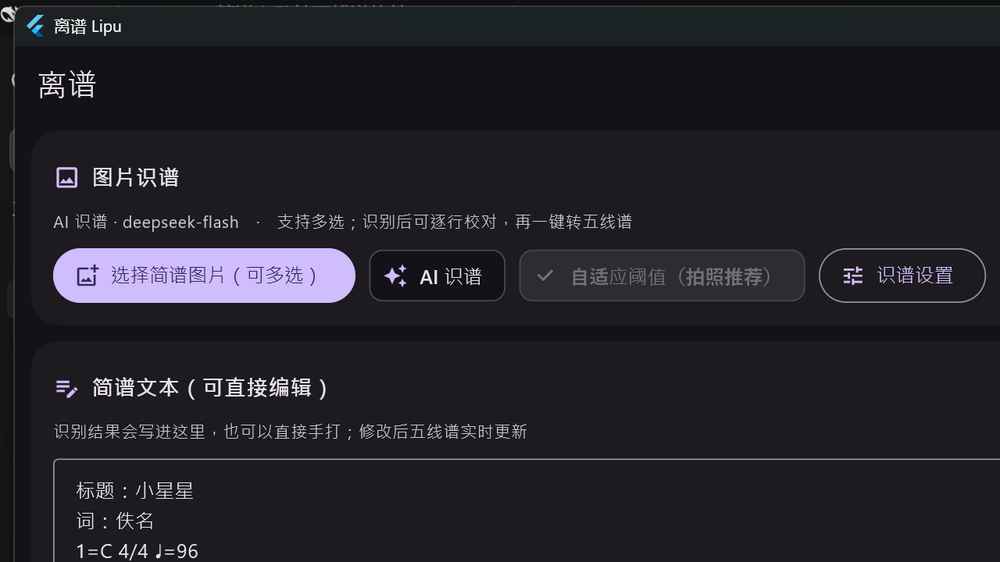
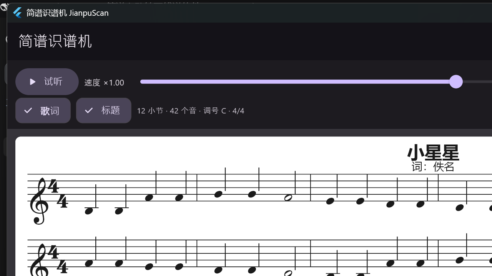
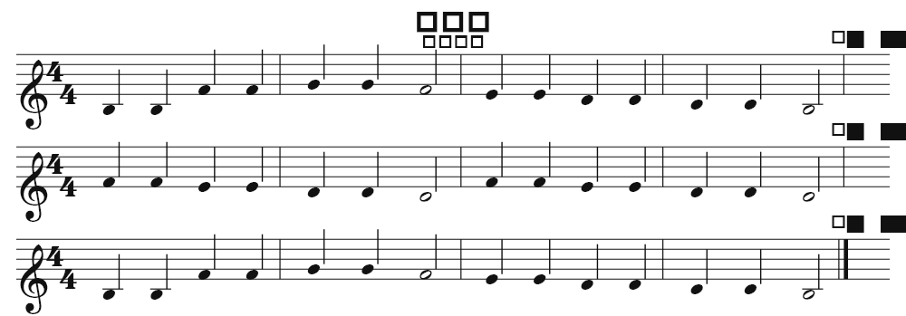

# 离谱 · 简谱识谱机

> **工程结构与资料索引**：见 [PROJECT-LAYOUT.md](PROJECT-LAYOUT.md)（工具入口、目录归属、收纳规则）

把**简谱**（numbered musical notation）自动识别出来，转换成标准**五线谱**，并导出 MusicXML / MIDI / PNG / WAV。

界面用 **Flutter + Material 3 / Material You** 实现（Android 12+ 直接取系统动态色），交付 **Windows 原生 exe** 与 **Android APK**。

| 识谱页 | 乐谱页 |
|---|---|
|  |  |

五线谱渲染效果（由排版引擎直接输出的 PNG）：



---

## 1. 功能

| 模块 | 能力 |
|---|---|
| **图片识谱（AI 视觉大模型）** | 视觉模型**直接输出结构化音符事件**（音级/八度/起始拍/时值/声部，JSON），不再经过"简谱文本"这一中间格式——节奏是数字而不是排版记号，误差小得多；这份数据本身等价于 MIDI 事件表，由它直接生成五线谱与 MIDI。实测一页 1189×1681 的双声部简谱（《春风吹》）**3.6 秒**转写完 |
| **听歌扒谱（离线神经网络）** | 音频文件 → **Basic Pitch**（Spotify 的 AMT 模型，ONNX 本地推理）逐音转写 → 主旋律提取 → 量化成乐谱；支持 wav/mp3/m4a/flac/ogg（Android 端用系统解码器，Windows 端支持 WAV）。**完全离线**，模型仅 230KB。自带示例：**Merry Christmas Mr. Lawrence 前 90 秒**（`assets/samples/merry_christmas.wav`，22050Hz 单声道，由 `tool/make_demo_sample.py` 从用户提供的音频转出；整首 4:49 转 WAV 要 12.7MB，示例只放一段，扒整首用「选择音频文件」） |
| **哼唱记谱（离线）** | 麦克风实时基频检测（YIN）用于回显，成谱同样走 Basic Pitch，跟着哼唱即可成谱 |
| **备选引擎** | 内置纯 Dart 基频跟踪（YIN + 谐波显著度 + Viterbi）保留为**后备引擎**，干净单声部哼唱同样可用，Basic Pitch 加载失败时自动回退 |
| **人工校对** | 识谱结果按行给置信度可勾选（多声部默认只取第一条旋律）；扒谱结果给**钢琴卷帘**，点音符即可删除/恢复 |
| **一键转换** | 识别/扒谱完成后点「转化为五线谱」直接出谱并跳到乐谱页 |
| **文本输入** | 直接敲简谱，实时转五线谱；识别/扒谱结果与手输文本走同一条解析/排版链路 |
| **五线谱排版** | **Verovio**（Web 生态最成熟的开源排版引擎，自包含 WASM 随包内置）从 MusicXML 出图：谱号、调号、拍号、符干/符尾成组、附点、加线、连音线、休止符、反复与终止线、歌词、**和弦**、**大谱表**（高音谱+低音谱两行）全部由它负责，版面接近 MuseScore；**A4 自动分页**（一页一张纸、可翻页）。内置排版引擎保留为兜底（WebView 起不来时自动降级） |
| **和弦与两个声部** | 简谱语法支持 `[1 3 5]` 写和弦；行首写 `高音:` / `低音:` 分出两个声部，自动排成大谱表；扒谱结果可一键拆成右手高音谱 + 左手低音谱并保留和弦 |
| **乐谱页直接改谱** | 在五线谱上**用一根手指/鼠标**改谱：**轻点**音符选中（主题色光环），**按住拖**上下改音高、左右改位置；**再轻点**同一个音符弹出**右侧竖条**，**上下滑动**挑几分音符（全 / 二分 / 四分 / 八分 / 十六分 / 三十二分 + 附点）；和弦里每个符头都能单独拖。反馈做得很直白：选中的**符头本体染成主题色** + 脉冲光环，拖动时原位置压暗、预览符头**带过渡滑动**并逐格弹一下、竖线导引标出目标拍位、顶部提示实时显示「音高 +1 · 位置 +4」，改完落点还会**闪一下**；一次拖动算**一步**撤销。改的是乐谱模型本身，简谱文本、MusicXML、MIDI、PNG 一起跟着变（截图见 `docs/screenshots/score_edit_selected.png`、`score_edit_dragging.png`） |
| **导出** | MusicXML 4.0（含 `<staves>`/`<chord>`/`<backup>`，MuseScore 等直接打开）、MIDI（和弦同时发声）、五线谱 PNG（**按 A4 每页导出一张**）、试听 WAV、简谱文本 |
| **试听** | 内置加法合成器（纯 Dart 生成 WAV），可调速度 |
| **命令行** | Node 版转换器，支持批量：简谱文本 → MusicXML / MIDI |

**隐私**：扒谱（含神经网络）全程离线，音频与模型都在本机；只有图片识谱会把图片发送到你填写的服务（默认 DeepSeek）。

> **关于"本地图片识别"**：早期版本内置了一套纯 Dart 的模板匹配识谱（二值化 + 连通域 + 字形分类）。
> 实测对真实谱页（双声部、小字号扫描件、手写体）准确率不达标，**已从产品中移除**，
> 识谱页现在只走 AI 视觉模型。相关实现仍保留在 `app/lib/omr/` 作为离线实验与回归测试用途，
> 但界面上已没有任何入口。

---

## 2. 目录结构

```
jianpu2staff/
├─ app/                          Flutter 应用（主力交付，exe + apk）
│  ├─ lib/
│  │  ├─ core/                   乐谱模型 / 简谱解析 / MusicXML / MIDI（纯 Dart，无 UI 依赖）
│  │  ├─ omr/                    图片识别：图像处理、字形分类、版面分析、模板生成、云端接口
│  │  ├─ transcribe/             音频扒谱：Basic Pitch 移植（basic_pitch*.dart）、DSP、切分、量化、WAV 解码、录音
│  │  ├─ render/                 五线谱排版（纯 Dart 布局）+ CustomPainter 绘制（Bravura/SMuFL）
│  │  ├─ audio/                  试听音频：真实钢琴采样播放（sampler/piano_samples）+ 兜底合成器（synth）+ 播放器
│  │  └─ ui/                     Material You 界面（识谱 / 扒谱 / 乐谱 / 导出 + 钢琴卷帘）
│  ├─ integration_test/          真机端到端测试（Basic Pitch 需要原生 ONNX Runtime，只能在真桌面跑）
│  ├─ test/                      290 项测试：核心逻辑 + OMR + Basic Pitch 对照官方实现 + 和弦/大谱表 + 渲染分页快照 + 谱面编辑 + 节奏识别 + 试听采样 + 分行并发识谱 + 后端注册表与可选增强包（CRNN / Tsumugi / 人声分离）
│  │  └─ fixtures/               只给测试用的音源（小星星/茉莉花/复调），**不打进安装包**
│  ├─ tool/                      构建、打包、模型/依赖拉取、示例音频与钢琴采样生成
│  │                              （`fetch_piano_samples.mjs` 从 Salamander 原始录音生成 assets/piano/）
│  ├─ samples/source/            用户提供的示例源音频 + 说明（内置示例就是它转出来的，见该目录 README）
│  └─ assets/                    Bravura 字体、内置示例音频（Merry Christmas 前 90 秒）、Basic Pitch 模型（230KB）、
│                                试听钢琴采样（30 个 WAV，约 5.8MB）
├─ third_party/onnxruntime-win-x64/  ONNX Runtime 官方发行包（由 tool/fetch-onnxruntime.ps1 拉取）
├─ src/core/                     同一套算法的 JS 实现（供命令行批量转换）
├─ cli.js                        命令行：简谱文本 → MusicXML / MIDI
└─ test/                         JS 侧单元测试（31 项）
```

---

## 3. 快速开始

### 3.1 直接使用构建好的程序

| 平台 | 文件 |
|---|---|
| Windows | `app/dist/离谱-win-x64.zip` → 解压后双击 `离谱.exe` |
| Android | `app/dist/离谱-android.apk` → 传到手机安装（允许“未知来源”） |

### 3.2 从源码构建

前置：Flutter SDK、JDK 17、Android SDK；Windows 桌面构建还需要 VS Build Tools 的 C++ 工作负载。

`tool/env-setup/` 里是本机实际用过的三个环境安装脚本（全部安装到 D 盘、全部走国内镜像），可参考或直接复用：
`setup-vs.ps1`（VS Build Tools C++ 工作负载）→ `setup-android.ps1`（Microsoft OpenJDK 17 + Android SDK）→ `setup-flutter.ps1`（Flutter SDK + Bravura 字体）。

```powershell
cd app

# Windows 原生 exe（会自动拉取 ONNX Runtime 发行包到 ../third_party/）
.\tool\build.ps1 -Target windows

# Android APK
.\tool\build.ps1 -Target apk

# 跑测试 / 静态分析
.\tool\build.ps1 -Target test
.\tool\build.ps1 -Target analyze

# 端到端测试（真桌面端跑，会真正加载 ONNX 模型做推理）
flutter test integration_test/basic_pitch_e2e_test.dart -d windows

# 整理成 dist/ 分发包
.\tool\package-dist.ps1
```

**Basic Pitch 模型**：`app/assets/models/basic_pitch.onnx`（230KB，Spotify 的 ICASSP 2022 模型 ONNX 导出，
自带 CQT 前端，输入就是 22050Hz 单声道 PCM）。模型随包发布、离线推理，无需任何 Python 环境。

**ONNX Runtime 原生库**：Windows 端 `flutter_onnxruntime` 默认在配置阶段从 github.com 下载发行包，
本机访问不了 GitHub，所以 `tool/fetch-onnxruntime.ps1` 会先把它落到 `third_party/onnxruntime-win-x64`
（走 `ghfast.top` 镜像），`windows/CMakeLists.txt` 再以 `USE_SYSTEM_ONNXRUNTIME` 使用本地副本并把
`onnxruntime.dll` 装到 exe 旁边。Android 端插件直接用 Maven 上的 `com.microsoft.onnxruntime:onnxruntime-android`。

**应用图标**：源图放在 `app/assets/icon/app_icon.webp`（1920×1920）。改图后执行一次

```powershell
cd app
flutter test test/icon_assets_test.dart   # 由源图重新生成各尺寸图标
```

会写出 Android 五档 mipmap（48/72/96/144/192）、Windows 的 `windows/runner/resources/app_icon.ico`（7 档）以及 `assets/icon/app_icon_1024.png`；之后重新 `-Target windows` / `-Target apk` 即可让 exe 与 APK 都用上新图标。

> 换完图标**要验证真的进包了**（我踩过"改了源图但没重新生成/没重新打包"的坑）：
> 从 APK 里解出图标对比 `docs/screenshots/apk_icon_v2_640.png`，
> 从 exe 里抽内嵌图标对比 `docs/screenshots/exe_icon_v2.png`。

> **几个环境坑（本机都已踩过，脚本里已处理）**
> 1. Flutter 在 Windows 上要求符号链接权限（需要“开发者模式”）。`tool/make-plugin-junctions.ps1` 用**目录联接**替代，免管理员权限。
> 2. `services.gradle.org` / `storage.googleapis.com` / `repo.maven.apache.org` 的大文件在本机不稳定，脚本统一走国内镜像（`storage.flutter-io.cn`、`mirrors.cloud.tencent.com`、`maven.aliyun.com`），并用 `gradle-home/init.d/mirrors.gradle` 覆盖插件自身的 buildscript classpath。
> 3. Android Gradle Plugin 在**含空格的路径**下解析 CMake 的 `buildFiles` JSON 会报 `MalformedJsonException`（影响 `path_provider`→`jni` 的原生构建）。`tool/build.ps1 -Target apk` 会自动建一个无空格的目录联接（`D:\jianpu2staff_build`）再构建。
> 4. `flutter_onnxruntime` 的 C++ 源码含非 ASCII 字符，在中文代码页（936）下 MSVC 报 C4819 而插件又开了 `/WX`，所以 `windows/CMakeLists.txt` 全局加了 `/utf-8`。
> 5. Android release 构建必须保留 `ai.onnxruntime.**`，否则 R8 会裁掉它导致模型加载失败；已放在 `android/app/proguard-rules.pro`。
> 6. **AGP 9 不再接受 `getDefaultProguardFile('proguard-android.txt')`**，而 `flutter_inappwebview_android` 1.1.3（当前最新版）还在用旧名字，Gradle **配置阶段**就整体失败。因为失败发生在配置期，init script 拦不住，只能改文件：`tool/patch-plugins.ps1` 会把插件里的旧名字换成 AGP 官方建议的 `proguard-android-optimize.txt`（幂等，`build.ps1` 每次构建前自动跑）。
> 7. `flutter_inappwebview_windows` 构建时要**用 NuGet 拉 WebView2 SDK**：`nuget.exe` 放在 `D:\android-dev\`（`build.ps1` 已把它加进 PATH）。运行时需要系统装有 **WebView2 Runtime**（Win10/11 一般自带）。

### 3.3 复现 Basic Pitch 移植的正确性（可选，需要 Python）

Dart 端的 Basic Pitch 是逐行对照官方实现移植的，仓库里带了**对照测试数据**：

```powershell
# 1) 装 Python 3.11 + basic-pitch（装到 D 盘、走清华 PyPI 镜像）
powershell -ExecutionPolicy Bypass -File app\tool\setup-python-basicpitch.ps1

# 2) 用官方库跑同一个 ONNX 模型，导出音频/切窗/模型输出/官方解码结果
D:\android-dev\python\python.exe app\tool\basicpitch_reference.py `
  app\assets\samples\xiaoxingxing.wav app\test\fixtures\basic_pitch `
  app\assets\models\basic_pitch.onnx 3.0

# 3) 跑对照测试（切窗逐位一致、解码逐个音符一致）
cd app; flutter test test/basic_pitch_test.dart
```

### 3.4 命令行批量转换（Node，可选，零依赖）

```bash
node cli.js 小星星.jianpu                    # 默认输出 musicxml + mid + 规范化简谱
node cli.js songs/ -o build/ -f musicxml     # 目录批量
node cli.js in.jianpu -f midi -o out.mid
```

---

## 4. 使用说明

1. **识谱页**：整页只有两个按钮 + 一个设置图标——
   - 「选择简谱图片」（可多选）→ 交给 AI 视觉模型逐音转写；
   - 「转化为五线谱」→ 识别完成后点它直接出谱并跳到乐谱页；
   - 右上角**设置**图标 → 填接口地址 / API Key / 模型名（兼容任何 OpenAI Chat Completions 格式的视觉模型，默认 DeepSeek，填 Key 即可用）。
   没配置 Key 时会明确提示去设置，不会偷偷降级。
   > 识别结果**不再需要人工逐行校对**：模型直接给结构化音符事件（声部已经分好、和弦已合并），
   > 所以「识别结果校对」和中间的「简谱文本」框都已去掉。Key 只存在本机应用私有目录，不打进安装包。
2. **校对**：取消勾选歌词行/误检行；识别结果写入下方文本框，可直接编辑，五线谱实时刷新。
3. **扒谱页** → 两个来源二选一
   - 「音频文件」：选 wav/mp3/m4a/flac/ogg → 自动解码 → Basic Pitch 神经网络逐音转写 → 主旋律提取；
     不想自己找文件的话有内置示例：**「示例：小星星」**（干净单声部）和 **「示例：带伴奏」**
     （主旋律 + 低音 + 琶音 + 噪声的复调混音，专门演示"从歌里抓主旋律"）
   - 「哼唱录音」：点「开始哼唱」，对着麦克风用“啊/啦”唱出旋律，界面实时显示当前音高与电平，点「停止并分析」
   - 引擎：`Basic Pitch 神经网络`（默认）/ `内置算法`（纯 Dart，后备）
   - 谱表：`两行谱表（右手+左手）`（默认开）把结果拆成大谱表并保留和弦；关掉则是单谱表（可用 `只保留主旋律` 去伴奏/泛音）
   - 参数：`歌曲主旋律模式` / `灵敏度` / `最短音符` / `速度 BPM`（自动或手填）/ `调号`（自动或指定）/ `拍号` / `量化网格`
   - **钢琴卷帘校对**：横轴时间、纵轴音高，蓝条是识别出的音符，点一下变红即删除，再点恢复；确认后点「生成乐谱」
4. **乐谱页**：A4 一页一张纸，左下角翻页（也可切「连续长图」）、缩放、开关歌词与标题、试听（可调速度）。
   顶部「编辑乐谱」把下半屏切成编辑器——**改简谱文本即时重排五线谱**，上半屏始终看得见谱面；
   编辑器里带示例（小星星/茉莉花）与简谱语法速查（识谱页精简后，手动编辑的入口在这里）。
5. **导出页**：MusicXML / MIDI / PNG（每页一张，文件名带 `_p1`）/ WAV / 简谱文本，优先弹系统「另存为」。

### 简谱语法（文本输入与识别结果共用）

| 写法 | 含义 |
|---|---|
| `1=C` `4/4` `♩=96` | 调号 / 拍号 / 速度（行首或单独一行，也接受 `1 = C`、`4 / 4` 这类识别结果写法） |
| `1`–`7`，`0` | 音级；0 为休止符 |
| `1'` `1''`（或 `1^`） | 上八度 |
| `1,` `1,,`（或 `1v`） | 下八度 |
| `1/` `1//` `1///` | 减时线：八分 / 十六分 / 三十二分 |
| `1.` `1/.` | 附点四分 / 附点八分 |
| `1-` `1--` | 延音：每个 `-` 延长一个四分音符 |
| `[1 3 5]` | **和弦**：方括号里两个以上记号同时发声（连写 `[135]`、后缀 `[1 3 5]/` 都认；主音自动取最低音） |
| `高音:` `低音:` | **声部前缀**（行首）：分出两行谱表，自动排成大谱表；也认 `上:` `下:` `右手:` `左手:` `RH:` `LH:` |
| `#4` `b7` `n1` | 升 / 降 / 还原 |
| `\|` `\|\|` `\|]` `\|:` `:\|` `:\|]` | 小节线 / 双线 / 终止线 / 反复 |
| `(1 2 3)` `6~ 6` | 连音线 |
| `1[啊]` | 歌词 |
| `标题：` `词：` `曲：` | 元信息 |

---

## 5. 技术实现

### 5.1 识谱（AI）流水线

```
图片 ──> 视觉模型（结构化输出）──> 音符事件 JSON ──> Score IR ──> MusicXML ──> Verovio 排版
                                        └──────────────> MIDI（同一份事件表）
```

- **为什么不用简谱文本做中间格式**：简谱要靠减时线（`/`）、附点（`.`）、延音横线（`-`）这些
  *排版符号*来表达节奏，模型很容易写错；改成让模型直接给
  `{degree, octave, accidental, start, dur, staff}` 的数字表后，节奏就是数字，误差小得多。
- **这份数据就是 MIDI 事件表**：`start`/`dur` 以四分音符为 1，与内部 IR 的 tick 一致，
  所以同一份数据可以同时产出五线谱（MusicXML → Verovio）和 MIDI 文件，不需要二次转换。
- **两个声部**：模型给 `staff: 1/2`，直接排成大谱表；同时起止的音自动合成**和弦**，
  跨小节的长音自动拆成连音线，空档自动补休止符（`lib/omr/ai_notes.dart`）。
- **la 记法小调**：简谱小调常写成 `6=A`（la 记法，谱面的 6 才是主音），而内部是 do 记法
  （调号字母 = 1 的音）。解析时会按 `6→1、7→2、1→3…` 把音级平移，
  所以 `6=A` 的谱子音高不会整体错位。
- **兜底**：模型若返回的是简谱文本（不是 JSON），自动退回原来的简谱解析路径；
  此时若正文恰好两条**小节数相同**的旋律线（钢琴谱的上下两行就是这个形态），
  会自动标成 `高音:` / `低音:` 两个声部——否则低音谱会被整条丢掉，只剩一行谱。
- **曲谱名字**默认跟随输入：识谱用第一张图片的文件名（模型给了标题就用模型的），
  扒谱用音频文件名；导出时文件名也用它。
- 提示词在 `CloudConfig.prompt`，可在设置面板里改；换任何 OpenAI Chat Completions 兼容的
  视觉模型只改地址与模型名。

#### 5.1.1 识谱速度：关掉"思考" + 分行并发

用户反馈"AI 识谱太慢了"。实测（春风吹 p1，`deepseek-flash`，同一张图反复跑）后发现，
**慢的根本不是图片大小、也不是音符多少，而是模型的"思考"**：

| 做法 | 耗时 | 输出 token | 其中"思考" | 音数 | 低音声部 |
|---|---|---|---|---|---|
| `reasoning_effort: low`（原默认） | **117s** | 32,394 | 30,043（94%） | 231 | 84 |
| 不传 reasoning_effort | 171s | 49,441 | 47,681 | 144 | 0（丢了） |
| 只给三分之一页 + `low` | 77s | 20,243 | 19,678 | 50 | — |
| 只读标题的一小块 + `low` | 2.9s | 513 | 481 | 0 | — |
| **关掉思考**（`reasoning_effort: none`） | **6~7s** | 2,142 | 0 | 196 | 50 |

关键结论：**思考 token 不随页大小等比减少**（整页 30K、三分之一页仍 20K），
所以"把一页切成几行并发"并不能解决主要矛盾——先关思考是 18 倍，再分行并发只是第二个 1.5 倍。
最终做法（两个开关，默认都开，设置面板里可关）：

1. **快速识谱**：请求里带 `reasoning_effort: "none"` + `thinking: {"type":"disabled"}`
   （两个写法都发，兼容 DeepSeek 系与其它 OpenAI 兼容服务）。有些服务不认这些字段会返回
   400，代码按"带 thinking → 只带 effort → 都不带"三级降级重试；快速模式还带 60 秒上限，
   真遇到"这次模型没听劝、又在思考"就掐掉重发，不让用户干等两三分钟。
2. **分行并发**（`lib/omr/ai_lines.dart`）：先用本地版面分析把整页切成"每组谱行一张小图"
   （二值化+纠斜后的干净小图，10~30KB，比原照片更适合模型读小圆点），
   连同"页眉"一起并发发给模型（实测 6 路并发最快：3 路 6.2s / 6 路 4.1s），
   拿回来按**小节**顺接：每段的时长按最近的完整小节数折算，作为下一段的起点偏移，
   各段的小节数也打进状态里便于核对。
   - 页眉（曲名/调号/拍号/速度）单独读一次；每段小图里**看不到调号**，所以解析时用
     页眉的调号**强制重解析**；页眉没读到就取各段的多数票——否则各段自己猜调号，音高会整体错位。
   - 版面里混进来的副标题行/页码行会被"字形数"筛掉（一行简谱有十几个到几十个数字，
     这类行没有）；万一段落返回空，按"这一段没有音符"处理，不当作失败。
   - **任何一段失败、或一半以上段落为空 → 自动退回"整页一个请求"的老路径**，结果不会更差。
3. **多张图并发**：以前几张图是一张一张串行识别的，现在默认 2 张同时跑（页内还会再并发分段）。

实测（同一页，同一次运行）：

```
整页一个请求：6.6s，188 个音，低音声部 44 个
分行并发：    6.0s，197 个音，低音声部 59 个   ← 每段小节 0/5/5/4/4/0
117s → 约 4~6s（约 25 倍），而且"分行"那条路的低音声部还更完整
```

#### 5.1.2 单行谱 / 双行谱：先判谱式，再决定怎么问

用户反馈"单行谱识别有错误"。查下来是**两种谱式的读法不同**：单行旋律谱只有一行数字，
数字下面是**歌词汉字**；钢琴双行谱每组上下各有一行数字。用双行谱的口径去问单行谱，
模型会把歌词行当成第二个声部、凭空编出一条低音谱；反过来把双行谱当单行读，左手整条就丢。

**让 AI 判版面、本地定像素**（各干自己擅长的）：

1. **AI 判版面**（`kAiLayoutPrompt`，一次调用，输出很短）：看整页，给出
   `{"title","key","layout":"single|grand|mixed","systems":[{"rows":1|2,"y0":0.05,"y1":0.13}, …]}`,
   即"每一组谱行有几行数字、大致在页面的什么位置"。
2. **本地定边界**：本地版面分析给出每一行的**精确像素范围**，AI 的归一化坐标只用来
   **吸附**到这些边界上（行的中心落进 AI 给的区间就算这一组的行）——
   AI 定位、本地定像素，AI 坐标略偏也不会把一行裁成两半。没有一组认领的行**单独成段，一行都不丢**。
3. **逐段用对应口径发问**：`rows=2` 的段用双行谱口径（上面 v1 下面 v2），
   `rows=1` 的段用单行谱口径（**只输出 v1、歌词不是音符**）；混排页面也能逐段分别处理。
   AI 只认领了一部分行（坐标/分组跟本地对不上）时，**退回本地几何分组**，并在状态里说明。

**本地几何判据**（实测两页得到的数字，作为交叉验证与兜底）：

| 量 | 二十二 p1（单行谱，字高 23px） | 春风吹 p1（钢琴双行谱，字高 17px） |
|---|---|---|
| 谱表行高 | 58~65px（约 2.5 个字高） | 拆声部后 58~150px |
| 歌词行高 | 22~23px（约 1 个字高） | ≤29px |
| 相邻两组谱行间距 | 12~37px（**最窄只有 1.4 个字高**） | 79~102px |
| 双行谱的两行怎么认 | — | `_splitVoices` 从同一个行带中间切开，**间距恰好 1px** |

> 一开始用"间距 ≤1.6 个字高就算同一组"的纯几何规则，结果二十二 p1 的 4 组谱行
> （695px）被串成了一大块——所以现在**只把"间距 ≤2px 的行"当作同一组**（那是拆声部拆出来的），
> 分组本身交给 AI 判断。

**顺带修掉的两个真问题**（都是这轮实测发现的）：

- **调号读丢了**：页眉只裁到"第一个谱行顶边"，而 `1=F 4/4` 那行紧贴在谱行上方 → 被切掉。
  于是各段自己猜调号，**集体猜成 1=C**（真相 1=F），整首差一个调。现在页眉往下多带 0.9 个字高，
  并且版面判断那一路也会读曲名/调号，两边互为兜底（页眉是放大过的，优先）。
- **多页统一调号**：一首歌通常只在第一页印调号，第 2 页模型只能猜。现在多张图一起识别时，
  用读到的调号（多数票）把没读到调号的页**重算一遍音高**（`rekeyAiScore`），并在状态里报"修正了几页"。
- **单行谱的谱号**：原来按"最低音+最高音取中"决定高音谱/低音谱，**一个音被读低一个八度就会
  把整页翻成低音谱**。现在单行谱用**中位音**判断（低于 E3 才用低音谱）。

实测（同一台机器，同一天）：

```
春风吹 p1（双行谱）：整页 6.9s/211 音（v2=67）；分行 5.4s/204 音（v2=44）✓ 低音声部都在
二十二 p1（单行谱）：5.5s，10 段，276 音（v1=276，v2=0）✓ 没有凭空多出低音，曲名=二十二，调号=1=F ✓
二十二 p2（单行谱）：11 段，253 音（v2=0）✓
```

```
灰度化
 → 自适应二值化（Sauvola 变体，积分图实现）/ 大津法
 → 倾斜校正（行投影方差最大化，±6°）
 → 8 连通域标记（含噪点过滤、孔洞统计）
 → 行分割（连通域纵向覆盖投影）+ 细行合并（八度点/附点并回数字行）
 → 字形分类：多字体模板 IoU + 形状特征（孔洞数 / 宽高比 / 墨迹密度）
 → 音符列分组（数字为锚，点/横线/变音记号按几何关系归属）
 → 修饰符判定：上下加点=八度，数字下方横线=减时线，同高短横=延音，右侧点=附点
 → 简谱文本 → 统一解析器 → 乐谱模型（Score IR）
```

- 字形模板在运行时用系统字体渲染生成并缓存（当前设备上的 13 种字体族 × 2 字重 × 斜体变体）。
- 分类器是**可插拔接口**（`GlyphClassifier` / `CloudRecognizer`），手写体可换成云端视觉模型，其余流程不变。
- 每个音符都带置信度与坐标，便于界面回显与人工校对。
- 曲谱标题默认跟随输入：识谱用第一张图片的文件名（模型自己给了标题就用模型的），
  扒谱用音频文件名——导出时文件名也用它。

### 5.2 扒谱 / 哼唱（音频 → 乐谱）

```
音频文件(任意格式) ──平台原生解码──┐
                                  ├─→ 单声道 22050Hz PCM
麦克风 PCM16 流 ──────────────────┘
   │
   ├─(默认)─ Basic Pitch 神经网络（离线，ONNX Runtime）
   │    补零 3840 → 按 hop 36164 切 43844 采样窗（≈2 秒）
   │    → onnx 推理 → note[172×88] / onset[172×88]
   │    → 每窗去掉首尾各 15 帧后拼接，裁到原长（移植官方 unwrap_output）
   │    → 峰值解码：约束频段 → 由帧差分补 onset → argrelmax 取峰
   │              → 从后往前扫能量、能量容差 11 帧 → melodia 补音（移植官方 output_to_notes_polyphonic）
   │    → 音符事件(start/end/midi/amplitude) → 帧号换秒（含官方对齐修正）
   │    → 主旋律提取（泛音去重 + 声部跟踪 + 低音清理）
   │
   └─(备选)─ 内置纯 Dart 算法
        分帧(46/93ms) → 加窗 FFT → YIN / 谐波求和显著度 → 中值滤波 → 能量门限
        → 切分（音高跳变 / 能量突增）→ 八度平滑、碎片合并
   │
   → 速度估计（起始间隔直方图众数）+ 调号估计（Krumhansl 调性轮廓相关）
   → 量化到 1/8 ~ 1/32 网格 → 跨小节自动拆连音线 → Score IR
   → 简谱文本 ──→ 与识谱/手输完全相同的排版与导出管线
```

**试听**：合成在**后台 isolate** 里跑（几千个音在 UI 线程上会明显卡顿），
预览用 22050Hz，超长曲子只合成前 5 分钟并在界面上说明；audioplayers 在部分机型上
会"报错但其实已经在放"，所以出错后以播放器**真实状态**为准，不轻易报失败。

**Basic Pitch 的 Dart 移植**放在 `app/lib/transcribe/basic_pitch.dart`（纯前后处理，无 Flutter 依赖）
与 `basic_pitch_engine.dart`（ONNX Runtime 会话、进度、主旋律提取）。移植遵循的三条原则：

1. **模型自带前端**：官方 ONNX 导出把 CQT 层也包进去了，输入就是原始 PCM，所以 Dart 端**不需要**实现 CQT；
2. **逐行对照**：切窗/拼接/解码全部按官方 `constants.py`、`inference.py`、`note_creation.py` 写，
   并用 `tool/basicpitch_reference.py`（真跑官方 Python 库）生成对照数据，`test/basic_pitch_test.dart` 断言逐位一致；
3. **有意差异只有两处**：不算 pitch bend（十二平均律记谱表达不了弯音）；`get_infered_onsets`
   里差分全零时官方会除零得 NaN，这里退化为只用模型给出的 onset。

- 推理在 UI isolate 上用平台通道逐步 `await`（原生侧算，界面不卡），**解码**（大矩阵峰值搜索）丢到后台 isolate。
- 音频分析在**后台 isolate** 里跑，界面不卡；钢琴卷帘可点选删改音符，改完再量化。
- 乐谱化用的仍是简谱文本这一"中间语言"，所以扒谱结果可以继续手工编辑、转五线谱、导出 MusicXML/MIDI、试听。
- 实现思路参考了 [noteDigger](https://github.com/madderscientist/noteDigger)（网页端频谱分析扒谱）的"自动分析 + 钢琴卷帘人工校正"产品形态，代码为独立实现。

### 5.3 简谱 → 五线谱

渲染交给 **[Verovio](https://www.verovio.org/)**（LGPL-3.0，Web 生态里最成熟的开源制谱引擎）：

```
Score IR ──toMusicXML()──> MusicXML 4.0 ──WebView 里的 Verovio(WASM)──> SVG ──> A4 分页显示 / PNG 导出
```

- **为什么用 WebView**：Verovio 是 C++/WASM，没有 Dart 绑定。塞进 WebView 是"一套代码 Windows + Android 都能用"的唯一实际做法——Android 用系统 WebView，Windows 用 WebView2，都不需要 Python / MuseScore / LilyPond。
- **资源落地**：Verovio 那个自包含的 JS（内嵌 WASM 与字形，约 7MB）从 assets 解压到临时目录，和 `index.html` / `harness.js` 放一起，WebView 直接以 `file://` 打开——同源、无 CORS，也不用往 WebView 里塞巨大字符串。
- **兜底**：WebView 或 Verovio 起不来时（例如系统缺 WebView2），自动退回内置排版引擎，保证"至少能看到谱"，界面上会明确标注用的是哪个引擎。
- **A4 分页**由 Verovio 负责（`pageWidth/pageHeight` 按 A4 比例、`breaks: auto`），翻页时只重画当前页；PNG 导出是在 JS 里把 SVG 画进 canvas 再导出（Verovio 的 SVG 里字形是路径，不依赖外部字体，所以栅格化是自包含的）。

内置排版引擎（`lib/render/staff_layout.dart`）仍在，但只作为兜底：
- 调号决定主音与音阶（大调 / 自然小调），按音级字母拼写
- 八度点 → 五线谱八度；减时线 → 符尾（同拍内自动成组）；延音线 → 时值合并；跨强拍自动拆分并补连音线
- **和弦**：同一时值的多个音高共用一根符干（符干方向按整组音的平均位置定），二度音程自动把符头挪到符干另一侧；变音记号按顺序往左排开
- **大谱表**：`高音:` / `低音:` 两个声部编译成两行谱表，左侧 Bravura 大括号（U+E000），两边都画谱号/调号/拍号，小节线贯穿两行，歌词只挂在高音谱下面；调号位置按谱号分别取（高音谱 F♯ 在第五线、低音谱 F♯ 在第四线）
- **A4 分页**：给定页高时先算每个系统的高度（含音符超出谱表的加线空间），再按页装箱；页内系统 y 坐标重新起算，一页一张纸
- 符干方向、加线、休止符、反复/终止线、歌词对齐、多系统分行
- 乐谱符号按 **SMuFL 码位**用 Bravura 字体绘制（谱号 U+E050/E062、大括号 U+E000、符头 U+E0A2–E0A4、符尾 U+E240+、休止符 U+E4E3+、升降号 U+E260–E262、拍号 U+E080+ …）

### 5.4 导出

- **MusicXML 4.0**：divisions=16、调号 fifths、拍号、谱号、tempo、连音线 tie/tied、符头类型与附点、歌词、反复与终止小节线；
  和弦写成带 `<chord/>` 的多个 note；大谱表写 `<staves>2</staves>` + 两个 `<clef number>`，第二行前用 `<backup>` 回到小节开头，每个音带 `<staff>`
- **MIDI**：SMF format 0，480 ticks/四分音符，VLQ 编码，tempo/拍号/调号元事件，连音线合并为单音；**和弦的各音同时 note on**，大谱表两个声部在同一时间轴上各自行走
- **WAV**：**真实钢琴采样**渲染（见 5.5），44.1kHz 立体声 16bit PCM；和弦与大谱表的所有音一起发声
- **PNG**：把排版指令绘制到 `ui.Image`，**按 A4 每页导出一张**（多页时文件名带 `_p1`、`_p2`）

### 5.5 试听（真实钢琴采样）

试听不是"合成音色"，而是**弹真实录音**：

- **音源**：Salamander Grand Piano V6.2 "Accurate"（Yamaha C5 近场录音，作者 Alexander Holm，**CC-BY-3.0**），
  原始是 48kHz/24bit 立体声、从小字组 A 起**每小三度**一个音、16 个力度层。
  `tool/fetch_piano_samples.mjs`（Node，无第三方依赖）从 HuggingFace 取原始 WAV，解码 24bit → 混单声道 →
  带限 sinc 重采样到 44.1kHz → 按音区截取 1.7~3.0 秒 → **相位对齐的交叉淡化循环点** → 写成 30 个 16bit WAV（共约 5.8MB）。
- **循环点怎么做的**：① 循环长度取基频**整数个周期**（基频用 FFT 谱峰折算，低音基频弱时用分音折算，精度 ±几音分）；
  ② 再把循环起点在 ±半周期内微调，取"结尾段与起点前一段"归一化相关最大的位置；③ 最后按等功率交叉淡化。
  这样长音靠循环延续时不会有接缝处的相位抵消（听着不会"发虚"）。
- **渲染器** `lib/audio/sampler.dart`：按最近采样变调（最多 ±1.5 个半音）、保留录音本身的起音与自然衰减、
  松键加制音包络（τ≈0.14s，不是硬切）、按音高做声像（低音偏左/高音偏右，最多 ±4dB）、
  立体声 Schroeder 混响（4 梳状 + 4 全通，梳状左右分开取用）、末级软限幅（0.72 以上平滑压到 1.0）。
  音高用**实测基频**把录音自带的钢琴伸张调律（低音最多 −20 音分）校正回等程律。
- **性能与内存**：**流式写文件**（不整块进内存），5 分钟曲子约 50MB 文件、渲染 ~1.5 秒
  （约 195× 实时，实测于 Windows 端到端测试）；渲染跑在**后台 isolate**，进度通过 `SendPort` 回传，
  界面显示"正在合成试听音频… 42%"这样的**真实百分比**。
- **兜底**：万一采样资源缺失（老包/裁剪构建），自动退回纯合成器（22050Hz 单声道），不会不能听。

---

## 6. 测试

```powershell
cd app; .\tool\build.ps1 -Target test      # Flutter 侧 290 项（AI 联网测试需设 DEEPSEEK_API_KEY，否则自动跳过）
node --test                                # JS 侧 30 项
```

- `core_test.dart`：调号/音高/时值拆分、简谱解析、MusicXML 结构、MIDI 字节与 VLQ、WAV 头
- `dsp_test.dart`：FFT 峰值精度、YIN 基频精度（含噪声/谐波）、谐波显著度主旋律提取、RMS/过零率
- `transcribe_test.dart`：WAV 编解码与重采样、音高与切分、速度/调号估计、量化小节容量、混音主旋律提取、**哼唱实时跟踪（喂入合成 PCM16 分块，模拟麦克风回调）**，以及**端到端往返**（简谱 → 合成音频 → 扒谱 → 简谱）
- `transcribe_snapshot_test.dart`：真实示例音频 → 扒谱 → 与**原谱逐音比对音高序列**，并输出钢琴卷帘/五线谱 PNG
- `omr_test.dart`：用系统字体合成简谱图（含八度点、减时线、延音短横、小节线、3° 倾斜）→ 跑完整识别 → 比对音级序列；**多张图片按顺序拼接**
- `real_image_test.dart`：**真实双声部谱页（`samples/real/春风吹_p1.jpg`）**的识别诊断与回归断言（连续四音 `3333/2222/1111`、标题行不得入选、声部必须拆开），并把二值图与行框叠加图 dump 到 `build/snapshots/`
- `ai_recognizer_test.dart`：AI 识谱联网集成测试（转写真实谱页 + 与本地解析器对接）
- `basic_pitch_test.dart`：**Basic Pitch 移植对照官方实现**——切窗逐位一致、去重叠拼接帧数与顺序、
  峰值解码出的每个音符（起止帧/音高/能量）与官方 `output_to_notes_polyphonic` 完全一致、
  帧→时间映射一致、主旋律提取结果正确（数据由 `tool/basicpitch_reference.py` 真跑官方库生成）
- `harmony_test.dart`：**和弦与大谱表**——`[1 3 5]` 语法与往返、两个声部按小节对齐、
  MusicXML 的 `<staves>`/`<chord/>`/`<backup>`、MIDI 和弦同 tick 起音、合成器按频谱验证和弦音真的发声、
  复调扒谱结果按音高分左右手并能导出、只有单声部时的降级提示
- `note_edit_test.dart`：**谱面直接编辑的 Dart 一半**——音符 id ↔ 小节/声部/条目/符头序号的映射（和弦按音高排序，
  每个符头独立）、拖动改音高（含跨八度 7→1）、改位置（补休止/截断/夹住，小节总时值不变）、改时值（变短补休止、
  变长吃掉后面的音）、`nudgeNote` 一步撤销、越界 id 不崩
- `rhythm_test.dart`：**节奏识别**——内置提示词必须讲清减时线/附点/延音线并带逐小节自检；"整页一个时值"的判据；
  发现节奏缺失后自动补救重问（且不会无限重问、不会浪费请求）；**三连音等精确时值必须活到乐谱里**（走完整识谱流程）
- `demo_sample_test.dart`：内置示例音频格式/时长正确，且**包里不再有小星星/茉莉花**（它们只作为 `test/fixtures/` 里的测试音源）
- `score_editor_test.dart`：乐谱页里那个内嵌简谱编辑器的解析/回写与示例按钮
- `piano_samples_test.dart`：**内置钢琴采样完整性**——30 个采样齐全（A0 起每小三度到 C8）、44.1kHz、
  循环点在文件内且长度合理、无静音、取最近采样最多移调 1.5 个半音、实测基频与等程律相差 < 40 音分（钢琴伸张调律）、CC-BY 署名不丢
- `ai_lines_test.dart`：**分行并发识谱的 Dart 一半**——按小节拼接（含 3/4 拍号、空段跳过、两个声部一起顺接、
  段尾多写半拍时按最近小节吸附）、页眉解析与曲名清洗（"简谱/未命名"不算曲名，但**曲名本身是数字的照收**，如《二十二》）、
  分段提示词（第几段 / start 从 0 / **单行谱要说"歌词不是音符、只输出 v1"** / 双行谱要分上下声部 / 通用提示词仍在）、
  **AI 判版面**（layout/rows/y 范围解析、0~100 坐标自适应、坏数据不崩、按 y **吸附到本地行边界**且没认领的行单独成段）、
  **调号与谱号**（`rekeyAiScore` 换调号重算音高、单行谱按**中位音**选谱号——一个跑偏的低音不会把整页翻成低音谱、双行谱必用大谱表）、
  切行几何（假谱页切出"标题区 + 3 组谱行"、单行谱只切一组、切出来的图能编码成 PNG）、限量并发工具
- `ai_lines_api_test.dart`：**真 API 对照**（需 `DEEPSEEK_API_KEY`，否则跳过）——三类页面各测一遍：
  **钢琴双行谱**（春风吹：分行后低音声部不能丢、音数不缩水）、**单行旋律谱**（二十二 p1/p2：
  不得凭空多出低音声部、开头音符顺序对、曲名与调号正确）、以及"关掉思考后单次请求仍是秒级"的防回归
- `sampler_test.dart`：**采样渲染器**——中央 C 与最低音 A0 的**音高**（自相关实测，误差 < 1%）、
  移调播放音高、时长 = 乐曲时长 + 尾音、**长音第 5~6 秒仍在响**（循环生效）、休止符不发声、
  四音和弦不削顶也不过轻、空谱不崩、大谱表两声部同时发声、进度回调单调递增到 1.0
- `render_snapshot_test.dart`：渲染谱例到 `build/snapshots/*.png`（含**和弦大谱表**、**长谱分页**），
  并断言 A4 分页不重不漏、每页内容不溢出页高
- `ui_snapshot_test.dart`：波浪进度条四态离屏渲染 + **A4 长谱版面回归**（44 小节必须排成十几行谱表，而不是被压窄成一条）
- `integration_test/basic_pitch_e2e_test.dart`：**真桌面端端到端**——加载 ONNX 模型、跑完整扒谱、断言小星星旋律与量化后的简谱（`flutter test integration_test/... -d windows`）
- `integration_test/score_edit_e2e_test.dart`：**真 WebView 里拖动音符**——派发真正的 `PointerEvent` 走完整条链路：
  命中符头 → 选中高亮 → 拖动预览 → 松手回传增量 → 改模型 → 重排 → 选中跟回来 → 时值条 → 撤销；
  同时断言"一个间 = 一级"和"右拖一拍正好落在第 1 拍"（所以要先用**音高差 vs 屏幕 y 差**量出一个间的高度）、
  大谱表低音声部同样可编辑。**这条测试抓到过一个 2 倍刻度错**：相邻音级只差**半个间**，拟合斜率要乘 2
- `integration_test/preview_audio_e2e_test.dart`：**试听链路真桌面端到端**——资源解包 → 采样加载 →
  后台 isolate 渲染（断言回报了百分比进度）→ WAV 落盘（RIFF 头 + 长度覆盖整曲）→ 真的播放起来；
  另测 300 秒长曲的渲染耗时（实测 1540ms，约 195× 实时）
- JS 侧：解析器往返、导出器结构校验

**实测数据（本机）**

| 场景 | 结果 |
|---|---|
| **Basic Pitch 扒谱（离线神经网络）** | 《小星星》示例音频：86 个原始音符 → 主旋律提取后 `[60,60,67,67,69,69,67, 65,65,64,64,62,62,60, …]`，**与原谱逐音一致**；量化结果 `1 1 5 5 \| 6 6 5 - \| 4 4 3 3 \| 2 2 1 - \| …` 与真值简谱完全相同；调号 C、96 BPM |
| **复调混音里的主旋律（关键场景）** | 自造测试音频 = 主旋律 + 低音（低两个八度）+ 琶音伴奏 + 0.4% 白噪声（`tool/make_polyphonic_sample.dart`）：**Basic Pitch 命中 42/42 = 100%**，同一段音频**内置纯 Dart 算法只有 73.8%**（53 个音里混进伴奏与泛音） |
| **音频 → MIDI / MusicXML 链路** | 同一份扒谱结果直接量化成乐谱并导出：MIDI 437 字节（`MThd`/`MTrk` 结构正确）、MusicXML 9322 字节 / 12 小节，小节数与乐谱一致 |
| **钢琴谱（大谱表 + 和弦）** | 同一段复调混音：拆出**高音谱 50 个事件 / 低音谱 42 个事件**，其中**8 个和弦**（同时发声的音已合并）；MusicXML 带 `<staves>2</staves>`、`<backup>`、`<chord/>`；简谱带 `高音:`/`低音:` 前缀且能往返 |
| **Basic Pitch 移植精度** | 与官方实现：切窗 43844 采样**逐位相同**；解码出的 11 个音符（起止帧/音高/能量）**完全一致** |
| 内置算法扒谱（备选引擎） | 干净单声部 42 个音，95 BPM，同样得到正确旋律 |
| **真实双声部谱页（AI 识谱）** | 《春风吹》p1（1189×1681）：**3.6 秒**转写完，上声部 `0 0 0 7 1 2 \|: 3 3 3 3 3 2 2 2 2 5 \| 1 1 1 1 1 6 7 5 3` **逐音与原谱一致**，自动分成上下声部两行；解析出 189 个音 |
| 《小星星》简谱 → 合成音频 → 内置算法 | 42/42 音符**音高序列完全一致**；速度精修到 96.1 BPM（真值 96），调号 C |
| 《茉莉花》简谱 → 合成音频 → 内置算法 | 26/26 音高序列完全一致；72.2 BPM（真值 72） |
| 哼唱记谱（合成 PCM16 分块喂入） | 116 帧全判为有声、稳定在 A4；哼唱 do-mi-sol 切出 `[60,64,67]`，量化成简谱 `1 3 5` |
| 单声部音阶 / 加 2% 噪声模拟哼唱 | 音高全部命中（YIN 实测最大误差 1.82 音分） |
| 旋律 + 更强低音伴奏（混音模式） | 正确抓旋律而非贝斯 |
| 合成简谱图 OCR（黑体/楷体/衬线体/倾斜 3°） | 音级序列全部正确 |
| 多张简谱图一次识别 | 逐张识别按顺序拼接，可逐页勾选/取消 |
| 打包后的 exe | 解压即运行，窗口标题 `离谱 Lipu` |

---

## 7. 已知限制

- 乐谱层面只处理**单声部主旋律**：多声部、和弦、装饰音、转调、散板、反复次数/房子等暂不支持（双声部谱面会识别成多条行，默认只取第一条旋律，可手动切换）
- **AI 识谱需要联网**并消耗你填写的服务额度；模型对**音高**很可靠，但减时线/延音线这类节奏记号常不够精确，转换后可能提示"小节时值超出拍号"，按实际节奏改一下即可
- **听歌扒谱**现在是 Basic Pitch 逐音转写 + 主旋律提取，仍只输出单声部：混音复杂（重打击乐、人声与伴奏同响）时会有漏音/多音，用钢琴卷帘人工修正
- **哼唱记谱**要求音高稳定、环境安静；用"啊/啦"等持续元音效果最好，说话或气声很难识别
- 音频文件：Android 端可直接读 mp3/m4a/flac/ogg（系统解码器）；**Windows 端目前只直接支持 WAV**，其它格式请先转成 WAV
- 大调与关系小调共用同一组音，调号估计可能给出关系小调（如把 1=D 记成 1=Bm），在界面改一下调号即可
- Basic Pitch 不算 **pitch bend**（简谱/五线谱的十二平均律记谱表达不了弯音），也不输出力度包络
- **APK 体积**：ONNX Runtime 的 ARM `.so`（arm64 18.4MB + armeabi-v7a 13.3MB）让安装包从 54MB 涨到约 85MB；
  已用 `abiFilters` 去掉只给模拟器用的 x86_64（省 22MB），需要模拟器调试时再临时加回
- 扫描质量差（重影、折痕、严重透视）会明显降低识谱准确率

## 8. 修复与优化记录

针对实际使用反馈修过的问题（都有测试守住）：

| 现象 | 根因 | 处理 |
|---|---|---|
| **真实简谱图片识别完全不可用**（整页全是 0） | ① 整页被压到长边 1800px，一行简谱的数字只剩 12~20px，模板匹配必然失效；② 双声部的上下两条旋律被并成一行；③ 标题/英文副标题行被当成简谱行选中 | ① 改为**先版面分析找行、再把每行裁出来放大到字高 ~42px 重新二值化识别**（内存只需一行的量级）；② 按行内"数字中心"的最大空隙**自动拆声部**；③ 行评分改为**以识别结果为准**（数字多、字母少、置信高才选） |
| 连续数字（`3333`、`712`）整段被丢弃 | 解析器要求音符之间有空格 | 解析前在"数字与数字之间"自动补空格；AI 提示词也要求写开 |
| AI 识谱返回空内容 | 推理模型的 token 全花在"思考"上 | 请求里带 `reasoning_effort: low` + 提高输出上限，正文即正常返回 |
| 选了 AI 识谱却报未配置 | — | 未配置 Key 时自动回退本地识别，并在状态里说明；设置面板可切换引擎、填 Key |
| 安卓选完谱子后识谱**直接闪退** | 自适应二值化给整图开了两张 `Float64List` 积分图（1800×1800 ≈ 52MB），叠加全尺寸 RGBA 解码，手机直接 OOM | 改成可分离滑动窗口（额外内存 O(宽)，几 KB）；用 `ImageDescriptor` 只按目标尺寸解码一次；模板渲染及时 `dispose`；移动端只用可用字体 |
| Windows 识谱"卡住不动" | 整条识别流水线跑在 UI 线程（二值化/连通域/分类都是长 CPU 任务） | 纯 Dart 分析全部移到**后台 isolate**；模板生成分片让出事件循环；启动后预热模板；**分阶段上报进度**并用波浪进度条显示 |
| 不能一次选多张谱子 | 只调用了单选接口 | 图片改为多选，逐张识别后按顺序拼成一份简谱，界面上按页分组校对 |
| 扒谱把整首歌判成"没有声音" | 静音门限按噪声底推导；连续不断的音乐噪声底≈峰值，门限高过信号 | 门限改为 `clamp(20%分位×1.6, 峰值×2%, 峰值×25%)`，两种极端都能覆盖 |
| 同音重复（`1 1`）被并成一个音 | 只有音高跳变才切分 | 增加 **RMS 起音检测**（正向差分局部极大），并让起音阻止后续合并 |
| 扒谱十几秒后节奏错位 | 速度估计有 1%~3% 偏差，随时间累积导致网格错位 | 增加**速度精修**：在估计值附近搜索让起始点最贴合十六分网格的速度，并偏爱整数 BPM |
| 混音里跟着贝斯跑 | 单帧显著度无法区分低音伴奏与旋律 | 显著度矩阵 + **Viterbi 时域跟踪**（跳变代价 + 音区先验），八度/低音乱跳被自然抑制 |
| 识谱页"自适应阈值"按钮显示不全、步骤编号繁琐 | 按钮排在一行且语义分层过多 | 按钮行改为**可横向滑动**；去掉"第一步/第二步"，合成单张「图片识谱」卡片，设置图标里选 **AI 识谱 / 本地识别**；识别完直接给「转化为五线谱」按钮 |
| 进度条是平直的 | 用的是系统 LinearProgressIndicator | 自写**波浪进度条**：一条圆头粗正弦波表示进度 + 末端圆点（对齐常见 App 的波浪样式），见 `docs/screenshots/wavy_progress.png` |
| **长谱被压成一条细线** | 乐谱页用 `FittedBox(scaleDown)` 把整份谱塞进屏幕：曲子一长，高度撑开导致整体缩到十几分之一 | 改为 **A4 版面**（固定 794 逻辑像素宽排版）+ `InteractiveViewer(constrained:false)` 平移缩放，打开时自动适配宽度，另给「适配宽度 / 100%」按钮与 A4 分页虚线；PNG 导出同步改成 A4 宽 ×2.5 倍 |
| 换掉应用图标（自带的 Flutter 蓝标） | 图标散落在 Android mipmap、Windows `.ico`、应用内展示三处 | 以 `assets/icon/app_icon.webp` 为唯一源图，`test/icon_assets_test.dart` 一次性生成**五档 Android mipmap + 7 档 Windows `.ico` + 1024px 预览图**；已解包 APK 与 exe 复核图标确实生效（`docs/screenshots/apk_icon_640.png`、`dist_exe_icon.png`） |
| 安卓应用名显示成「线线」 | 我用 PowerShell 批量改名时踩了**数组展平**的坑（`@(@('a','b'))` 被展平成两个字符串，于是变成逐字符替换：`谱`→`线`），把 `android:label` 从「离谱」改坏成「线线」，同时损坏了 `staff_layout.dart` 的中文注释 | 用**扁平数组 + 显式步进**的方式重写替换（不再嵌套），逐个文件修复并复查：应用名恢复「离谱」，注释恢复「五线谱/谱表/谱号/距离」等正确用词 |
| **本地识谱准确率太低**（用户反馈"完全不可用"） | 模板匹配对真实谱页（双声部、小字号扫描件、手写体）先天不足，放大优化后仍达不到可用水平 | **从产品里移除本地识谱**：识谱页只剩「选择简谱图片」+ 设置两个按钮，引擎固定为 AI 视觉模型；未配置 Key 时给出明确指引而不是悄悄降级；相关实现保留在 `lib/omr/` 作为离线实验与回归测试 |
| 扒谱准确率不够 | 纯 DSP（YIN + 显著度 + Viterbi）在混音里分不清伴奏与旋律，泛音也会被当成独立音 | 引入 **Basic Pitch**（Spotify ICASSP 2022，Apache-2.0）：官方 ONNX 导出自带 CQT 前端，输入原始 PCM，模型仅 230KB，用 ONNX Runtime 在本机推理；Dart 端逐行移植官方解码并用官方 Python 库生成对照数据守住一致性；实测小星星**逐音全对**、量化结果与真值简谱完全相同 |
| Windows 上 `flutter_onnxruntime` 编译不过 | ① 插件在 CMake 配置阶段从 github.com 下载 ONNX Runtime（本机访问不了）；② 插件源码含非 ASCII 字符，中文代码页下 MSVC 报 C4819，而插件开了 `/WX` | ① `tool/fetch-onnxruntime.ps1` 走 `ghfast.top` 镜像预取官方发行包到 `third_party/`，`windows/CMakeLists.txt` 用 `USE_SYSTEM_ONNXRUNTIME` 指向本地副本并自行把 `onnxruntime.dll` 装到 exe 旁边；② 全局加 `/utf-8` 编译选项 |
| Android release 包模型加载失败 / 包体暴涨 | ① R8 会裁掉 `ai.onnxruntime.**`；② ONNX Runtime 的 `.so` 按 ABI 各带一份 | ① 补 `android/app/proguard-rules.pro`；② `abiFilters` 只保留 arm64-v8a + armeabi-v7a，去掉只给模拟器的 x86_64（省 22MB） |
| 改 `build.ps1` 后脚本语法报错 | Windows PowerShell 5.1 把无 BOM 的 UTF-8 当 GBK 读，新加的中文注释里有全角括号，解码时**吞掉了后面的引号** | 把所有构建脚本改成 **ASCII-only**（含说明注释），并在文件头写明原因；中文只留在 README 与 Dart 注释里 |
| **调号 #/b 画错位置** | 排版里的调号位置表（`sharpSteps`/`flatSteps`）换算错了半间距，G 大调的 F♯ 被画到了 C5 的位置 | 按 SMuFL 标准重算，并**分谱号两套**：高音谱 F♯ 在第五线（+8 半间距）、低音谱 F♯ 在第四线（+6）；顺带修掉"调号已隐含的升降号又画一遍"的问题，调外音取消调号时补还原号 |
| 音符跑出谱表被上一行盖住 / 掉出页边 | 系统的固定高度没算上加线需要的空间 | 分行时先算每个系统的最高/最低音超出谱表多少，给系统加 `padTop`/`padBottom`，分页装箱按加高后的高度算 |
| **进度条只有一个波浪线、不显示进度** | 调用方在 `0 < value < 1` 时传了 `null`（表示"进度未知"），而 AI 识谱那条路径**从没更新过进度值** | 波浪条一律用确定进度：Basic Pitch 按推理窗口上报真实百分比；AI 识谱/内置算法按**已用时间**做渐近估算（封顶 92%/90%）并显示"已用 x.x 秒 + 百分比"；两处都补上右侧百分比数字 |
| 乐谱是一整张长图，看不出分页 | 只在长图上画了 A4 分页虚线 | 排版引擎**真正按 A4 分页**（先算系统高度再装箱，页内 y 重新起算）；乐谱页一页一张纸、左下角翻页（`第 x / y 页`），也可切回连续长图；PNG 导出改成每页一张（`_p1`/`_p2`） |
| 用户反馈"改了但还是没有新功能" | 手机上装的是**旧 APK**，从界面上看不出来是哪个版本 | 顶栏标题下常驻版本号（`v1.2.1 (build 4) · A4 版面修复 · 标题跟随曲名`，见 `lib/core/version.dart`），并把 `pubspec.yaml` 的 version 提到 `1.2.1+4`——**versionCode 变化后系统才会当成升级包**，避免"装了没反应" |
| **手机上 A4 版面被横向拉宽、下半页被裁掉** | Verovio 输出的 `<svg>` **没有 viewBox**，只带 `width`/`height` 属性；我为了自适应宽度把这两个属性删掉再 `width:100%`，浏览器就失去了宽高比，元素塌成默认 ~150px 高，谱面被横向拉宽 + 纵向裁掉 | `draw()` 里先把原尺寸转成 `viewBox` 再让宽度自适应；集成测试直接量纸张尺寸断言 `794×1123`（A4）；顺手把 WebView 设成 `useWideViewPort: false` |
| **AI 识谱返回空内容**（改成结构化输出后复现） | 新提示词要求整页音符事件，输出比简谱文本长得多，而推理模型的 reasoning token 先花掉预算：实测 `max_tokens=16000` 时 reasoning 就用掉 15999、正文为空 | 输出上限提到 **65536**（已验证 API 接受），并把格式换成**紧凑数组** `[音级,八度,起始,时值]`：同一页从"53 个音就提前收尾"变成 **220 个音全部输出**，且 0 条小节时值告警 |
| 小调谱子音高整体错位 | 简谱小调常写 `6=A`（la 记法，谱面 6 才是主音），而内部是 do 记法（调号字母 = 1 的音） | 解析时识别 `6=X`，按 `6→1、7→2、1→3…` 平移音级；`1=Am` 这种 do 记法不受影响，两种写法都有测试 |
| 点"试听"卡一下、弹"播放失败"、然后又正常播放 | ① 合成整首曲子（几千个音）跑在 UI 线程上；② audioplayers 在部分机型上 `play()` 会抛异常但实际已在播放 | ① 合成移到**后台 isolate**、预览降到 22050Hz、超长曲子只合成前 5 分钟并在界面说明；② 出错后以播放器**真实状态**为准，不轻易报失败；试听过程显示"正在合成试听音频…" |
| 曲谱名字不是曲子名 | 扒谱固定写"扒谱结果"，识谱沿用模型给的标题（没有就是空） | 曲谱标题自动跟随输入：扒谱用音频文件名、识谱用第一张图片名（模型给了标题就用模型的）；`QuantizeOptions.title` 统一入口，导出文件名也随之变化 |
| 每一行谱表都标一次 `♩=96` | 速度记号画在 `_layoutSystem` 里，而每行都会调用它 | 加 `showTempo` 参数，只有第一行标一次 |
| **Verovio 报 `Unsupported note-type-value 'q'`**（自家 MusicXML 其实是错的） | 导出器把内部时值代号（`w`/`h`/`q`/`8`/`16`）直接写进了 `<type>`；MusicXML 规范要求 `whole`/`half`/`quarter`/`eighth`/`16th`。MuseScore 能忍，**Verovio 直接拒绝** | 加 `musicXmlNoteType()` 做映射，三处 `<type>` 全部改掉；对照测试与 Verovio 渲染测试都覆盖 |
| `file://C:/...` 这种 URI 让 Windows 端 WebView 静默加载失败 | 手写 `'file://' + path` 得到的 URI 少一个斜杠（应是 `file:///C:/...`），WebView 不报错也不加载 | 改用 `Uri.file(path).toString()`；并给 `VerovioController` 加了诊断日志（console/加载错误都留档），失败时能直接看出卡在哪一步 |
| 切「标题/歌词」开关谱面不重排 | 渲染缓存键只用了 MusicXML 文本，而这两个开关是渲染参数、不在 XML 里 | 缓存键带上开关状态；歌词干脆做成 `toMusicXML(includeLyrics:)` 参数（Verovio 没有"隐藏歌词"选项） |
| 想改谱只能改简谱文字，不直观 | 之前只有"文本 → 谱"单向链路 | 谱面**直接编辑**：MusicXML 里给每个音写 `id="lipu-小节-声部-条目-符头-片段"`，Verovio 会原样保留到 `<g class="note">`；WebView 里做命中测试与拖动，只把"改了几级/几格/什么时值"回传给 Dart，改谱逻辑仍在 Dart（可测试、可撤销） |
| 拖动改音高时把和弦里别的音改掉了 | `NoteItem.degree` 永远只是**最低**那个音，而我拿它当"被拖的那个符头"用了 | 抽出 `sortedTones()`/`toneAt()`：id 里的符头序号是**按音高排序**的下标，读写单个符头都走它（`note_edit_test.dart` 里有和弦用例守住） |
| **拖动刻度差了 2 倍**（拖一条线会跳两级） | 相邻音级在谱表上只差**半个间**，而最小二乘拟合出来的斜率正好是"半个间"：我当成一个间用了 | `space = -2 × 斜率`；并加了一条**独立交叉验证**——符头高度本来就约等于一个间，两者对不上就直接失败（就是这条把 2 倍错抓出来的） |
| 拖动"没反应"或一碰就变 | 死区写死 5px，而一个间在 A4 上只有 ~7px（一级 = 3.4px），死区比一级还大 | 死区跟着刻度走：`clamp(一个间 × 0.45, 2, 3.5)` |
| 量"一个间"量到了 300 多 | Verovio 的 `<g class="staff">` 里既没有 `.staffline`，bbox 也不止 5 条线（第一版就是拿它 /4 算的） | 改成**不依赖任何 class 名**：用所有音符的 (音级, 屏幕 y) 做最小二乘拟合；屏幕像素 ↔ SVG 内部坐标则一律用 `getScreenCTM()` 反解（Verovio 的组上带 `scale`/`translate`，拿 viewBox 硬算必错） |
| 改完位置后选中丢了、没法接着调时值 | 挪位置会改变条目序号，音符 id 跟着变，旧 id 找不到了 | `nudgeNote`/`setNoteDuration` 返回**新 id**，重排完成后由页面 `vrvSelect()` 把它选回来（集成测试断言选中确实跟到了新 id） |
| **点击/拖动的反馈太不明显**（用户反馈"看不出来选中了、拖动像没反应"） | 第一版只画了一个 0.25 透明度的小椭圆 + 0.5 的预览点，而且**完全没有动画**：符头只有 9×7px，几乎看不出差别 | 做成一套明确的反馈：① 选中的**符头本体染色**（Verovio 字形吃 `currentColor`，实测 `rgb(0,0,0) → rgb(103,80,164)`）+ 光晕 + 比符头大 3 倍的**脉冲光环**（27×26px vs 9×7px）；② 拖动时原位置压暗到 0.3、预览符头用 `transform` 过渡**滑**过去并逐格弹一下、加一条竖线导引标目标拍位；③ 顶部提示放大加粗、数字高亮，时值条从底部滑出并标出当前时值；④ 改完重排后落点**闪一下**（0.7s 扩散淡出）指明"就是它变了"；⑤ 颜色跟着 Material You 主题走（`vrvSetAccent`） |
| 修反馈时又踩了一个坑：光环越点越大 | 高亮图层插在符头**前面**，而 `headOf()` 取的是 `g.note` 里第一个 `use/path/ellipse`，于是量到的是光环自己（第一次 24px，再点更大） | 图层改插在音符**后面**，并且 `headOf()` 显式跳过 `.vrv-hl/.vrv-ghost/.vrv-guide`；量"一个间/每拍多宽"也统一走 `headOf()` |
| 手势被打断时仍然改了谱 | `pointercancel` 和 `pointerup` 走同一个收尾逻辑 | `pointercancel` 视为放弃，不提交编辑；`vrvClearEdit()` 也会回报"取消选中"，Dart 侧状态不会残留 |
| **点音符拖动"无任何反应"**（用户反馈） | 三个原因叠在一起：① 命中测试只认**精确点中符头**，而 A4 适配宽度时符头只有 9×7px，鼠标/手指一点偏就什么都不发生；② 交互层只监听 `pointerdown/pointermove`，有些 WebView 递进来的是 `mousedown/mousemove`；③ `harness.js` 的路径固定，**升级后 WebView 缓存了旧文件**，新版本装了却还是老行为 | ① 命中测试加**容差**（鼠标 14px / 手指 26px）并退化为"找最近的符头"；② pointer 与 mouse/touch **两套都绑**，谁先到谁生效（后到的重复事件丢掉，避免一次点击被当成两下直接跳进时值模式）；③ harness 落到**带内容指纹的目录**（`lipu_verovio_<hash>`）并清掉旧目录，URL 一变缓存自然失效；④ 交互层没绑上时工具栏直接显示「**交互未就绪，点此重载**」，兜底排版也写明"不支持拖动编辑"——不再有"点了没反应但看不出去哪了" |
| **改了提示词但用户手机上完全没效果** | 设置面板保存时把**提示词正文一起写进** `ai_recognizer.json`，而读取时优先用存下来的那份——升级后读回来的还是旧版提示词，我改的节奏规则一次都没生效；顺带老配置里的 `maxTokens: 16000` 也会截断长输出 | `CloudConfig` 加 `promptRev`/`promptCustom`：**用户没自己改过提示词时一律用随包发布的内置提示词**（装好首次启动即生效，不必重新保存设置），`maxTokens ≤ 16384` 视为历史遗留抬到当前默认；设置面板显示「识别提示词：内置 v2（随版本更新）」便于核对 |
| **手机上一根手指改不了谱**（用户反馈"要点音符后拖动、还要两个指头"） | 两个叠加问题：① **按下的瞬间就切换模式**——选中后再按住拖会被当成"第二次点击"切成时值模式，拖动被吃掉，只能两个指头凑合；② 手机 A4 适配宽度时"一个间"只有 3~5px，按 1:1 算一手抖就跳好几级 | ① 改成**松手时**才判断：没移动 = 轻点（选中/开时值条），移动了 = 拖动——于是一根手指"点一下→按住拖"完全够用；② 触摸拖动给**步长下限**（一级 ≥9px、一格 ≥22px），屏幕预览与落点用同一步长；③ 时值条按用户要求改成**屏幕右侧竖条**（上=更长），**上下滑动**选档、滑动中实时高亮、松手才提交（只重排一次），另留"附点/完成"两个按钮 |
| **放大/缩小按钮点了没反应** | 页面里 `html,body{overflow-x:hidden}` + flex 居中：放大后纸张比屏幕宽，被**裁掉**而不是可滚动，看着就像"没放大" | 去掉 `overflow-x:hidden`、`#wrap` 改块级 + `#paper{margin:0 auto}`，放大后可以横向滚过去看（端到端断言：纸张 794px → 1588px 且 `scrollWidth > clientWidth`） |
| 修完反而"彻底没反应"（用户反馈第二次） | 我在气泡的 `touchstart` 里调了 `preventDefault()` —— 浏览器一旦看到 touchstart 被取消，就**不再派发后续的 click**，于是按钮彻底点不动 | 气泡**一律不 preventDefault**；动作改在 `pointerup / touchend / mouseup / click` 四条路径里执行（时间戳去重，同一次点只执行一次），并在容器上加了**按坐标兜底**的 touchend 处理 —— 哪条事件链能到就靠哪条，不再赌 click |
| 测试为什么没提前发现（两次都漏） | ① 第一版测试直接 `.click()`，绕过了 `pointerup`；② 改成真实顺序后，`pointerup` 又是打在 `window` 上——而浏览器是打在**手指底下的那个元素**上，于是按钮自己的 `pointerup` 监听永远不触发 | 测试改成照浏览器的样子派发：`pointerdown`/`pointerup`/`touchend` 都打在目标元素上（靠冒泡到 window），并专门加了"**只发 pointerdown+pointerup、不发 click**"和"**只发 touch 事件**"两条用例 |
| **手机上气泡里的"时值/连音/插入/升降调"全都没反应**（用户反馈） | 手指点气泡是 pointerdown → pointerup → **click** 三步：`pointerup` 先被 `window` 上的谱面收尾逻辑收到，那里把编辑状态清掉了（隐藏气泡、`ED.id` 置空），等 `click` 触发时已经没东西可改——四个按钮全部空转。**我原来的测试图省事直接 `.click()`，正好绕过了这一段**，所以测试是绿的、手机是死的 | 气泡在 **pointerdown** 时就 `markOverlay()` 声明"这一下是我的"，谱面收尾逻辑直接让路；测试也改成按真实顺序派发 pointerdown → pointerup → click（这条回归就靠它守住） |
| 时值只有右侧竖条，且没有和弦/删除（用户需求） | — | ① 时值气泡改成**贴着音符弹出**的竖排（上下滑动或点选）；② 加**和弦**（三度叠置叠音，反复点得到 1-3-5，导出带 `<chord/>`）；③ 加**删除**（换成同时值休止符，小节长度不变）；④ 连音改成"再点另一个音符"两点相连（`tieBetween`），比"连到下一个"更符合直觉；⑤ 升降调确认符号写在音符前并写进 MusicXML（`<accidental>sharp</accidental>`） |
| 手机"轻点两下出不来时值条" + "点音符误触"（用户反馈） | ① 命中容差给到 26px，第二次轻点常常落到**旁边**的音符上（于是被当成"换了一个音"而不是"再点一下"）；② 网页允许双击缩放，Android WebView 把连点两次当成**双击放大**，第二次点击根本到不了页面 | ① 容差收紧到手指 12px / 鼠标 8px，并加**粘性**：已选中音符 1.6 倍容差内仍然认它，不会跳邻居（端到端断言：点旁边 18px 仍选中原音、点 70px 外则取消选中）；② `html,body,#wrap` 加 `touch-action: manipulation` 关掉双击缩放 |
| 拖动提示是"固定大小的顶部横幅"（用户反馈） | 提示用的是 HTML 固定定位，放大谱面后字号不跟着变、位置也和音符脱节 | 改成**画在 SVG 里**的提示气泡（`g.vrv-tip`）：贴在目标音符上方、字号按"一个间"的比例算，跟着谱面一起缩放 |
| 第二次轻点只有时值条，缺"连音/插入/升降调"（用户需求） | 之前只有时值条 | 加**气泡菜单**：时值 / 连音 / 插入（音符·休止符）/ 升降调（♯·♭·还原）。新增三个乐谱操作：`toggleTie`（连音线，两端都写进 MusicXML）、`insertAfter`（放得下就变长、放不下就挤掉末尾）、`setToneAccidental`；顺带修掉导出器的 bug——手动连音只写了 `<tie type="stop"/>`，**没写 start**，所以谱面上根本画不出连音线 |
| 休止符（停顿）"没注意"（用户反馈） | 三连音的浮点误差（0.333+0.333+0.334 = 0.999）会在小节里生成 `休止(0.001 拍)` 这种垃圾休止符；更主要的是那次识别**没走结构化路径**——模型写成了简谱文本，音数从 ~200 缩水到 32，节奏与休止跟着一起糙了 | ① 时值/起点统一**吸附到 1/48 拍细网格**（二分 24、四分 12、八分 6、十六分 3、附点四分 18、三连音 16 都能整除），比网格还小的空档不再生成休止符；② 模型没返回 JSON 时**自动换"只输出 JSON"的提示重问一次**；③ 识别完成的状态直接报**走的哪条路径 + 音数 + 时值种类**（`结构化 177 个音 · 时值 8 种` / `⚠ 简谱文本兜底，音数通常偏少`），不再出现"看着不对但不知道卡在哪"。真 API 实测：春风吹第 1 小节 `0 0 0 712` 被正确识别为 **休止 3 拍 + 三连音**，MusicXML 27 个 `<rest/>`、Verovio 画面上 27 个休止记号（`docs/screenshots/chunfengchui_AI识谱_含休止.png`） |

| 连音"选了之后点另一个音符只是把它选中、没有连音线"（用户反馈） | 进入"等第二个音"模式后，浮层标记 `markOverlay()` **只有 500ms 有效期**：手指按久一点（手机上很常见）松手时标记已过期，`pointerup` 又被谱面收尾逻辑当成"点了空白"，`clearEdit()` 把连音模式清掉；另外 Dart 侧一个陈旧的"待恢复选中"也会用 `selectNote(...,position)` 把模式重置 | ① 浮层标记有效期提到 **2.5s**，且手指重新按到谱面时立即释放；② 气泡开着 / 等连音第二点时轻点同类音符不再清空状态；③ Dart 侧特殊模式下不抢选中、并丢掉陈旧待恢复项；④ 连音选点容差放宽到 26px 且不做"粘住原音符"；⑤ 端到端加上"**按住 800ms 再松手**"用例 |
| 连音"有的音符连上后没有连音号"（用户反馈） | 连音线（tie）在 MusicXML 里**只能连同音高、且相邻的两个音**；连的两个音音高不同时 tie 无效，排版引擎直接不画 | 按音高自动选记号：**同音高且相邻 → tie；音高不同或中间隔着音 → 圆滑线（slur）**，谱面上都是"连音线"。`NoteItem` 增加 `slurToNext/slurToPrev`，导出写 `<slur type="start|stop" number="1"/>`；实测两条路都画得出来（画面 tie=2 / slur=2） |
| 乐谱页文字太杂（用户要求） | 标题栏挂着一长串更新说明，工具栏还有"Verovio 排版""点音符拖动改谱"两颗说明性标签 | 标题栏只留 `v1.6.7 (build 17)`（`kAppBuildNote` 仅作版本记录、不再显示）；乐谱页去掉那两颗标签，只留功能性控件（编辑乐谱/歌词/标题/撤销），「交互未就绪，点此重载」只在真的没绑上时才出现 |
| **试听音效很差**（用户反馈） | 试听用的是纯 Dart 合成器：22050Hz 单声道、**所有音固定 4 个谐波**（1/0.45/0.22/0.1，低音只剩头几个谐波→像风琴、高音又太单薄）、衰减时间与音高无关（统一 `exp(-1.1t)`）、没有力度/失谐/混响，末级还是硬 `clamp` 削顶 | 换成**真实钢琴录音**：内置 Salamander Grand Piano V6.2（Yamaha C5，CC-BY-3.0）30 个采样（A0 起每小三度），`tool/fetch_piano_samples.mjs` 把 48kHz/24bit 立体声转成 44.1kHz/16bit 单声道，并生成「**基频整数周期 + 互相关对齐**的交叉淡化循环点」（避免接缝相位抵消）。新渲染器 `lib/audio/sampler.dart`：44.1kHz **立体声**、按最近采样变调（±1.5 个半音）、长音走循环延续、松键有制音包络、按音高做声像（低音偏左高音偏右）、立体声 Schroeder 混响、末级软限幅；渲染**流式写文件**（5 分钟曲子 105MB 不进内存）并**回报真实百分比进度**。实测：中央 C 音高误差 <1%、长音第 5~6 秒仍在响、四音和弦不削顶 |
| **AI 识谱太慢**（用户反馈，并提议"分行并发"） | 实测发现：慢的不是图片大小也不是音符数量，而是**模型的"思考"**——整页输出 32,394 token 里 **30,043（94%）是推理**，耗时 117s；而"思考量"**不随页面变小而等比减少**（只给三分之一页仍要 20K 推理 / 77s），所以单纯切行并发只能省一半 | 两步：① **关掉思考**（`reasoning_effort: none` + `thinking:{type:disabled}`，不认这两个字段的服务按三级降级重试；快速模式带 60 秒上限，遇到"模型没听劝又在想"就掐掉重发）→ **117s → 6~7s**；② **分行并发**：本地版面分析把整页切成"每组谱行一张二值小图"（10~30KB），与页眉一起并发请求（实测 3 路 6.2s / **6 路 4.1s**），回来按**小节**顺接，页眉调号**强制重解析**每段（页眉没有就取多数票），副标题/页码行按"字形数"筛掉，任一段失败或过半为空则**自动退回整页单请求**。另把多张图从串行改成 2 张并发。实测同一页：整页 6.6s/188 音 vs 分行 6.0s/**197 音**（低音声部 44 → 59 个，更完整）；`lib/omr/ai_lines.dart` + 16 项单元测试 + 1 项真 API 对照测试 |
| **单行谱识别出错**（用户反馈，并建议"内置两种模式自动识别"） | 两种谱式的读法不同：**单行旋律谱**只有一行数字、下面是歌词汉字；**钢琴双行谱**每组上下两行数字。用双行谱口径问单行谱，模型会把歌词当第二个声部、编出一条低音谱；反过来会丢掉左手。另外纯几何分组也不可靠：二十二 p1 的相邻谱行只隔 **1.4 个字高**，"间距 ≤1.6 字高算同一组"会把 4 组谱行串成 **695px 一大块**（实测踩到） | ① **AI 判版面**（一次短调用，看整页）：给出曲名/调号/`layout`/每组谱行有几行数字及其归一化 y 范围；② **本地定像素**：AI 的坐标只用来**吸附**到本地算出的精确行边界（行中心落进区间即认领），没被认领的行单独成段**一行不丢**；③ **逐段用对应口径发问**（单行段明说"歌词不是音符、只输出 v1"），AI 只认领一部分行时**退回本地几何分组**；④ 本地判据实测：谱表行高 ≈2.5 字高、歌词行 ≈1 字高、**拆声部拆出来的两行间距恰好 1px**（所以只把 ≤2px 的行当同一组）。顺带修掉三个真问题：**调号被裁掉**（页眉没带 0.9 字高，`1=F` 那行在裁切线外 → 各段集体猜成 1=C，整首差一个调）、**多页调号不统一**（第 2 页没印调号 → 现在用多数票重算那几页的音高 `rekeyAiScore`）、**单行谱谱号**（原来按最低+最高取中，一个音读低一个八度就整页翻成低音谱 → 改用中位音）。实测：二十二 p1 单行谱 10 段 276 音（**v2=0**，曲名=二十二，调号=1=F）、春风吹 双行谱 204 音（v2=44，没丢低音）、二十二 p2 11 段 253 音 |
| **和弦识别不准**（用户反馈） | 用户以为模型听不出和弦。**实测反转**：用内置钢琴采样渲染已知和弦（三和弦/七和弦/低音+和弦/开放排列）喂给 Basic Pitch，**recall 全部 100%**（和弦音一个不漏）；真正的误差是 **precision**——多出**八度/十二度泛音鬼影**（C4 的二次谐波被当成 C5）。而"真八度叠置"与"谐波鬼影"在**响度/时长/频谱残差**上都分不开（真 C5 = 0.43/0.19s，鬼影 C5 = 0.48/0.21s，完全重叠） | ① 修正测量方法（第一版把 44.1kHz 直接喂给要 22050Hz 的模型，整体低一个八度，差点误判成移植 bug；现在测量走 App 自己的 `loadAudioFile()`）；② 新增 `integration_test/chord_accuracy_test.dart` 作为**可复跑的准确率基准**；③ 试过并**否掉**两套自动去鬼影（响度+时长判据 → recall 掉到 88%；频谱残差验证 → 全局幂律版把真音删了、局部插值版一个鬼影也去不掉），如实记在 `docs/和弦识别-测量记录.md`；④ 改为**把判断交给用户**：新增 `lib/core/chord_analysis.dart`（模板匹配判 C/Am7/G7…，标出**缺音/多音/八度重复**）+ 乐谱页「和弦核对」入口逐条列出，**不自动改谱**；⑤ 顺带修掉一个真 bug：复调（保留和弦）模式以前**完全不做泛音清理**。另合并"同一次触键的重复检出"（注意不能按时间重叠合并——实测会把同一音在两个和弦里的两次弹奏并成一个长音） |
| **更高准确率的扒谱后端**（用户要求接入 CRNN 与 Tsumugi，都做成可选包） | 内置 Basic Pitch 只有 230KB、和弦 recall 已 100%，但 precision 有泛音鬼影；用户希望有更强的模型可选 | ① **可选包机制**（`lib/transcribe/model_packs.dart`）：按需下载 + **支持 Range 断点续传** + **字节数与 SHA256 双校验**（不符就删掉报错）+ 从文件导入 + 可删除，包放在应用私有目录 `packs/`；② **ByteDance 钢琴 CRNN 已接入**（147MB，MIT，Kong et al. 2021）：`lib/transcribe/crnn_engine.dart` 跑 ONNX（输入就是波形 `[1,160000]`，mel 前端在图里），扒谱页引擎下拉框可选；实测（App 自己的引擎跑真模型）**recall 100% / precision 83%**，90 秒真实录音 11.6s；③ 途中靠数据定位并修掉一个真 bug：模型对同一个音**连续多帧**报 onset、而 offset 紧跟其后，会配对出 20ms 假音被最短时长滤掉 → **整个音消失**（B4 就是这么丢的），现在规定"offset 必须比 onset 晚 ≥30ms"；④ **int8 动态量化实测失败并放弃**（体积只降到 113.5MB、音符数 74→17、还慢 11 倍，因为参数大头在 Conv 上而动态量化只动 MatMul），包改用 fp32；⑤ **Tsumugi 经评估无法按原计划导出 ONNX**（神经半-CRF 的解码是 `@torch.jit.script` 动态规划，仓库无任何导出支持），UI 暂不提供该入口，结论与两条备选路线记在 `docs/和弦识别-测量记录.md` |
| **Tsumugi 自导出 ONNX + 半-CRF 解码移植**（推翻上一行里"导不出"的结论） | 权重只有 PyTorch（14M 参数），仓库**没有任何 ONNX 导出**，解码核心是神经半-CRF 的动态规划 | ① 用 **`torch.onnx.export(dynamo=True)` 导出成功**（老 TorchScript 导出器过不了 CQT 里 `torch.stft` 的复数张量），**数值与 PyTorch 一致到 1e-5**（独立进程复核）；② **照官方源码 1:1 移植**打分矩阵与分段 Viterbi（`buildIntervalScores` / `viterbiDecodeIntervals`，20 项单测），移植中对照出我原先两处写错：对角项是 **加上** `interval_diag`、长度项用 `\|end-begin\|`（不是 +1）；`noiseScore` 官方是**全零**；③ 提速：裁帧到真实音频长度 + 区间跨度上限 6 秒 → 打分 1800ms→**560ms**、Viterbi 65→**15ms**，**精度不变**；④ 三后端同台：recall 全 100%，precision **BP ~91% / CRNN 83% / Tsumugi 90%**，速度 CRNN 0.13×、Tsumugi 0.55× 实时 |
| **人声分离包（大小可选）** | 用户要求"用伴奏转谱，小的大的模型都做成可选，让用户自己决策" | ① 登记两个可选包：**UVR-MDX KARA2**（50.8MB，MIT）与 **htdemucs**（172MB，**许可未标注、如实标注让用户决策**）；② 查明**宿主契约**（模型卡写死，参数不能猜）：44100Hz 立体声 → STFT `n_fft 5120 / hop 1024 / periodic Hann / reflect 居中` → 取前 2048 bin 且 0..2 置零 → `[1,4,2048,256]` → 掩蔽频谱 → 置零 2048+ → iSTFT + overlap-add（一块 261,120 样本）；③ 实测图优化**开关结果逐位相同**（无 ORT 融合风险）、速度 **0.59× 实时**；④ Dart 侧 STFT/ISTFT 待实现 |
## 9. 第三方资源

- [Bravura](https://github.com/steinbergmedia/bravura) 乐谱字体 —— SIL Open Font License 1.1
- **试听音源**：[Salamander Grand Piano V6.2 "Accurate"](https://sfzinstruments.github.io/pianos/salamander/)
  （Yamaha C5 近场录音，作者 **Alexander Holm**）—— **CC-BY-3.0**。
  随包发布的 `assets/piano/*.wav`（30 个采样，A0 起每小三度一个音，共约 7MB）由
  `tool/fetch_piano_samples.mjs` 从
  [HuggingFace 上的 48kHz/24bit 立体声原始录音](https://huggingface.co/datasets/EinWWW/Accurate-Salamander-Grand-Piano-Yamaha-C5)
  转成 44.1kHz/16bit 单声道，并生成"相位对齐的交叉淡化循环点"。
  转换脚本可随时重跑（`node --use-system-ca tool/fetch_piano_samples.mjs`）。
  授权要求署名，所以**不要删掉本节与 `assets/piano/manifest.json` 里的 attribution 字段**。
- [Basic Pitch](https://github.com/spotify/basic-pitch)（Spotify AB）音频转 MIDI 神经网络 —— **Apache-2.0**；
  随包发布的 `assets/models/basic_pitch.onnx` 是该模型 ICASSP 2022 版本的 ONNX 导出（230KB，自带 CQT 前端）。
  Dart 端 `lib/transcribe/basic_pitch*.dart` 为**对照官方实现独立移植**（切窗/拼接/峰值解码三段算法一致，
  已用官方 Python 库生成的对照数据逐项验证），未直接拷贝其代码。
- [ONNX Runtime](https://github.com/microsoft/onnxruntime)（Microsoft）—— **MIT**；推理引擎与原生库
- [flutter_onnxruntime](https://pub.dev/packages/flutter_onnxruntime)（masic.ai）—— MIT，Flutter 侧的 ONNX Runtime 封装
- Flutter / Dart —— BSD-3-Clause
- 扒谱功能的**产品形态**参考 [noteDigger](https://github.com/madderscientist/noteDigger)（GPL-3.0，网页端频谱分析扒谱）；本项目为独立实现，未使用其代码

### 关于 Demucs / OmniZart / music21

需求里提到的另外三个 Python 方案，评估后**没有**内置进 App，原因记录在这里：

| 方案 | 结论 |
|---|---|
| [Demucs](https://github.com/facebookresearch/demucs)（人声/伴奏分离） | 效果确实好，但 htdemucs 权重是**几百 MB 级**，而且要 CPU 跑几分钟；对"14MB 免安装 exe + 手机 APK"的交付形态不合适。当前用"Basic Pitch 逐音转写 + 主旋律提取"覆盖了大部分收益（见 `pickMelodyNotes`），后续若要做可以按"可选下载增强包"的形式加 |
| [OmniZart](https://github.com/Music-and-Culture-Technology-Lab/omnizart) | PyTorch 实现、依赖重，且偏多乐器/古典场景，对流行歌主旋律并不比 Basic Pitch 好；不引入 |
| [music21](https://web.mit.edu/music21/) | 只用于"MIDI → MusicXML"。本项目本来就是**直接生成 MusicXML 4.0**（调号/拍号/连音线/歌词/反复都自己写），比"先转 MIDI 再让 music21 反推记谱"少一次有损转换，还能控制排版语义，所以不引入 |

> 本轮确实按需求把"音频 → MIDI"这一步做成了真的：扒谱结果是标准音符事件，
> 可以直接导出 SMF format 0 的 MIDI（导出页），也从同一份音符事件直接生成 MusicXML 与简谱。
